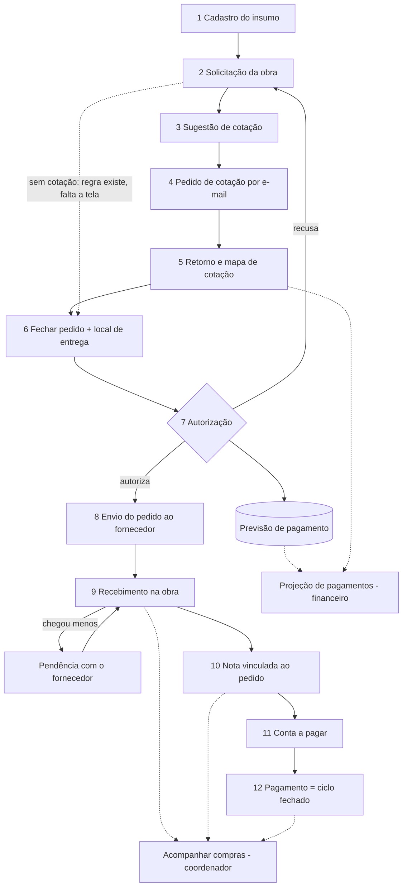

# A cadeia de compras — do insumo ao pagamento

> Retrato de **20/11/2026**. Escrito a pedido do dono: *"preciso que você me
> detalhe como está funcionando a cadeia de compras (…) quero um fluxograma de
> como tudo está funcionando."* A versão para ler no celular foi publicada como
> página (artefato "Cadeia de Compras BWS"); esta é a memória.

## O caminho

| # | Passo | Quem | Tela | Código | Situação |
|---|---|---|---|---|---|
| 1 | Cadastro do insumo | suprimentos | Cadastros › Insumos | `insumos.py`, `cadastro.py` | pronto |
| 2 | Solicitação | obra | Solicitações | `solicitacao.py`, `leitura.py` | pronto |
| 3 | Sugestão de cotação | sistema + comprador | Planejar cotações | `planejamento.py`, `regioes.py` | pronto |
| 4 | Pedido de cotação | comprador | Cotações › Disparar | `envio.py`, `cobranca.py` | pronto (cobrança só por e-mail) |
| 5 | Retorno e mapa | comprador | Cotações | `proposta.py`, `cotacao.py`, `precos.py` | pronto |
| 6 | Fechar pedido | comprador | Cotações › Fechar pedido | `pedido.py`, `entrega.py` | **feito em 20/11** — não havia botão |
| 7 | Autorização | diretoria | Pedidos | `pedido.autorizar` | pronto |
| 8 | Envio ao fornecedor | comprador | Pedidos › Ver e mandar | `envio.montar_pedido` | pronto (texto; PDF proposto) |
| 9 | Recebimento | obra | Receber material | `recebimento.py` | **feito em 20/11** — a obra não tinha tela |
| 10 | Nota × pedido | obra / comprador | Financeiro › Notas | `core/notas/cruzamento.py` | pronto, manual |
| 11 | Conta a pagar | obra lança, financeiro analisa | Financeiro › Lançar | `core/titulos/` | pronto, manual |
| 12 | Pagamento e fechamento | financeiro / coordenador | Acompanhar compras | `acompanhamento.py` | **feito em 20/11** |

**As visões cruzadas:** Painel (`acompanhamento.planejamento` — o item da obra
e o prazo dele), Acompanhar compras (`acompanhamento.painel` — o registro de
todos os pedidos), Projeção de
pagamentos (`projecao.py`), Compras (`compras.py`), Banco de preços (`precos.py`).

## Onde cada informação fica guardada

| Informação | Tabela |
|---|---|
| o que a obra pediu, e quanto já chegou | `suprimento_itens` (`quantidade`, `quantidade_recebida`, `status`) |
| preços cotados | `cotacao_precos`; histórico em `precos_historico` (COTADO / COMPRADO) |
| o pedido e seus itens | `pedidos_compra`, `pedido_itens` |
| onde desce, quando não é na obra | `pedido_entregas` (migração 120) |
| a previsão de pagamento | `previsoes_pagamento` (nasce na autorização) |
| cada chegada | `recebimentos`, `recebimento_itens` |
| a nota do pedido | `documentos_fiscais.pedido_compra_id` |
| a conta a pagar daquela nota | `titulos.documento_fiscal_id` → `parcelas` |

⚠️ **O elo fraco:** o pedido chega ao financeiro por **pedido → nota vinculada →
título lançado com a nota**. Se alguém lançar a conta sem vincular a nota ao
pedido, o painel continua dizendo "falta lançar a nota" e a projeção continua
contando o valor. `previsoes_pagamento.titulo_id` existe e ninguém o preenche.

## Os dois modelos que ele mandou, e o que o ERP tem

**Mapa de cotação (nº 9228)** — planilha com até 10 fornecedores em coluna,
pagamento / condição / entrega / frete / desconto no cabeçalho, preço e
subtotal por item, menor preço destacado, e quatro resumos: por item, por
fornecedor, melhor fornecedor único, e fornecedores. **O ERP já tem os quatro**
(Relatórios do mapa) e o mapa em PDF. Diferenças a favor do ERP: a situação de
cada item ao lado dele, preço herdado marcado, proposta lida por IA. O que o
modelo tem e o ERP não: o número da solicitação em cada linha do mapa e a
linha "Aprovação".

**Pedido de compra (ID 19457)** — PDF com logo, nº do pedido, CNPJ de
faturamento, tabela (nº da solicitação, item, insumo, unidade, qtd, unitário,
total), obra, endereço com CEP e link do Google Maps, valor / desconto / total,
fornecedor com CNPJ, forma de pagamento, condição, previsão, frete, três
instruções para a nota fiscal e a assinatura do comprador com telefone.
**O ERP manda o mesmo conteúdo como TEXTO de e-mail** (desde 20/11 com CNPJ de
faturamento, CEP, link do mapa, solicitação por item e as instruções da nota).
Falta: o PDF em si, a assinatura do comprador (nome, cargo, telefone, imagem) e
a "forma de pagamento" separada da "condição" (Pix × boleto × faturado).

**Proposta de pedido melhor que o modelo** (esperando o "sim" dele): PDF anexo
com a logo da empresa da obra; um bloco por local de entrega, com subtotal por
bloco; quando o local não é a obra, o destaque e a obra de origem; parcelas
com data e valor (o modelo só diz "30 dias"); contato de quem recebe na obra;
e um código do pedido para o fornecedor citar na nota — é por ele que a nota
capturada da SEFAZ vai casar sozinha com o pedido.
